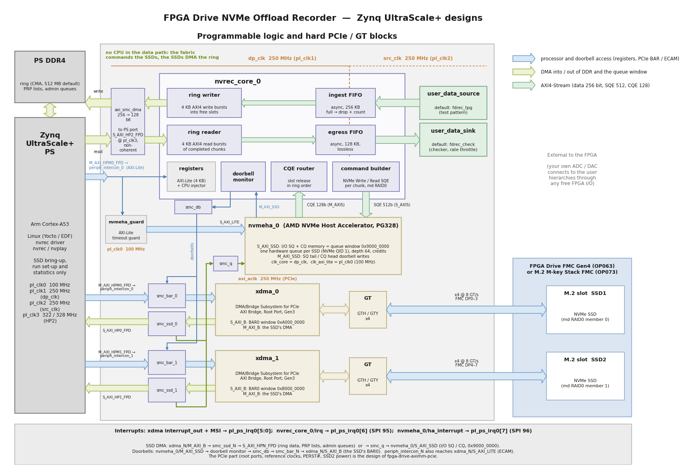

# FPGA Drive NVMe Offload

## Description

This reference design records data generated in the FPGA fabric to a file on one or two NVMe
SSDs connected through Opsero's [FPGA Drive FMC Gen4] (OP063) or [M.2 M-key Stack FMC]
(OP073), and plays recordings back into the fabric, **with no CPU in the data path**.

The fabric writes the stream into a ring of buffers in DDR and builds every NVMe command
itself; the AMD [NVMe Host Accelerator] IP queues the commands and rings the SSD doorbells;
the SSDs move the data to and from DDR on their own. Linux (Yocto) sets the SSDs up,
provides an exFAT filesystem (one contiguous file per recording, copied off the board with
`scp`) and reads the statistics. The data source in the design is a test pattern generator
that models an ADC and that you can replace with your own logic. Every recording reports the
number of beats dropped (zero for a valid recording), and the `nvverify` tool checks a
recorded file word by word. Recordings can also be played back into the fabric, where a
hardware checker (or your own data sink, such as a DAC) consumes them at a set rate.

> **License required.** This design contains the AMD NVMe Host Accelerator, an IP core that
> is licensed separately from Vivado. **Every target needs a license for it** (purchased, or
> an evaluation license, which is free from AMD) to synthesize, implement and generate the
> bitstream. To get an evaluation license, go to the AMD licensing site
> ([xilinx.com/getlicense](https://www.xilinx.com/getlicense)), search for the NVMe Host
> Accelerator IP and generate an evaluation license, then install it like any Vivado license
> (for example in `~/.Xilinx/`, or with `XILINXD_LICENSE_FILE`). With an evaluation license, the Host Accelerator in the bitstream stops
> 183-184 minutes (about 3 hours) after the bitstream is loaded, and a power cycle (bitstream reload) restarts it;
> the design detects the stop and reports it cleanly ("Host Accelerator stopped responding
> (evaluation license expired?)", exit code 5) instead of hanging the system. No other FPGA
> Drive reference design needs an IP license. The VCK190 target also needs a Vivado
> Enterprise license for its device.
>
> **The prebuilt boot images of the releases are built with the evaluation license**: the Host
> Accelerator in them stops 183-184 minutes after the board is powered on (power-cycle to
> restart it). They are meant for evaluation; for longer operation, build the design with a
> purchased license.

Important links:

* Datasheet for the [FPGA Drive FMC Gen4]
* Datasheet for the [M.2 M-key Stack FMC]
* The user guide for this reference design is hosted here: [FPGA Drive NVMe Offload docs](https://offload.fpgadrive.com "FPGA Drive NVMe Offload docs")
  (the sources are in [`docs/`](docs/source))
* The Linux-driven sibling design: [FPGA Drive Recorder](https://recorder.fpgadrive.com "FPGA Drive Recorder docs")
  ([fpga-drive-recorder](https://github.com/fpgadeveloper/fpga-drive-recorder))
* The AMD [NVMe Host Accelerator] product guide (PG328)
* To report a bug: [Report an issue](https://github.com/fpgadeveloper/fpga-drive-nvme-offload/issues "Report an issue").
* For technical support: [Contact Opsero](https://opsero.com/contact-us "Contact Opsero").

## Architecture



* AXI-Stream datapath at 250 MHz: 256 bits (8 GB/s) on the Zynq UltraScale+ targets, 512 bits
  (16 GB/s) on the Versal target (128, 256 or 512 bits are build options); the fabric writes
  the stream into a ring of chunks in PS DDR (512 MB by default; a chunk is 1 MB, or the
  drive's maximum transfer size (MDTS) when that is smaller: one chunk is one NVMe command).
* For every filled chunk, fabric logic (`nvrec_core`) builds a 64-byte NVMe Write command and
  hands it to the NVMe Host Accelerator, which queues it and rings the SSD's doorbell. The
  SSD reads the data from DDR by itself. Up to 63 commands are in flight per SSD.
* Completions come back to the fabric, which releases the ring slots in order. With two SSDs
  the chunks are striped in the Linux md RAID0 layout, so the array also assembles on a PC.
* The source is never stalled: if the ring is full, beats are dropped and counted.
* `user_data_source` and `user_data_sink` are the block-design hierarchies to replace with
  your own logic ([custom data source](https://offload.fpgadrive.com/en/latest/custom_source.html),
  [custom data sink](https://offload.fpgadrive.com/en/latest/custom_sink.html)); they are the same as in
  fpga-drive-recorder.
* The register map is in [`include/nvrec_regs.h`](include/nvrec_regs.h) and
  the [register map](https://offload.fpgadrive.com/en/latest/register_map.html) page.

### How this differs from fpga-drive-recorder

[fpga-drive-recorder](https://github.com/fpgadeveloper/fpga-drive-recorder) records the same
fabric stream on the same boards and SSDs, but through Linux: an AXI DMA fills hugepage
buffers and the recorder app writes them to an XFS file with `O_DIRECT` io_uring writes, so
the stock NVMe driver and the Linux block layer issue every command, and the CPU does the
bookkeeping for every buffer. This design moves the command path into the fabric: no CPU in
the data path, more commands in flight per SSD, but an IP license, its own NVMe driver, and a
recording file that must be preallocated as one contiguous run on an exFAT volume. Both
designs are measured with the same SSDs and the same method; see the
[benchmarks](https://offload.fpgadrive.com/en/latest/benchmarks.html) and the [comparison](https://offload.fpgadrive.com/en/latest/comparison.html).

## Requirements

This project is designed for version 2025.2 of the AMD tools (Vivado / Vitis) and the
AMD Yocto / Embedded Development Framework (EDF) 2025.2. There is no PetaLinux flow and no
standalone (baremetal) flow.

To build and test the design you will need:

* Vivado 2025.2 and **a license for the AMD NVMe Host Accelerator IP** (purchased or
  evaluation)
* Vitis 2025.2 (provides `sdtgen`/`xsct` for the Yocto flow)
* A Linux build machine for the Yocto flow (see [Yocto/README.md](Yocto/README.md))
* [FPGA Drive FMC Gen4] or [M.2 M-key Stack FMC]
* One or two M.2 NVMe PCIe SSDs (see [supported SSDs](https://offload.fpgadrive.com/en/latest/supported_ssds.html))
* One of the supported carriers listed below

## Target designs

<!-- updater start -->
### Zynq UltraScale+ designs

| Target board          | Target design   | M2 Slot 1<br> PCIe Lanes | M2 Slot 2<br> PCIe Lanes | FMC Slot    | Standalone | PetaLinux | Yocto | Vivado<br> Edition | IP<br>License |
|-----------------------|-----------------|--------------------------|--------------------------|-------------|-------|-------|-------|-------|-------|
| [UltraZed-EV Carrier] | `uzev`          | 4     | 4     | HPC         | :x:         | :x:         | :white_check_mark: | Standard :free: | Required |
| [ZCU106]              | `zcu106_hpc0`   | 4     | 4     | HPC0        | :x:         | :x:         | :white_check_mark: | Standard :free: | Required |

### Versal designs

| Target board          | Target design   | M2 Slot 1<br> PCIe Lanes | M2 Slot 2<br> PCIe Lanes | FMC Slot    | Standalone | PetaLinux | Yocto | Vivado<br> Edition | IP<br>License |
|-----------------------|-----------------|--------------------------|--------------------------|-------------|-------|-------|-------|-------|-------|
| [VCK190]              | `vck190_fmcp1`  | 4     | 4     | FMCP1       | :x:         | :x:         | :white_check_mark: | Enterprise | Required |

[UltraZed-EV Carrier]: https://www.xilinx.com/products/boards-and-kits/1-1s78dxb.html
[ZCU106]: https://www.xilinx.com/zcu106
[VCK190]: https://www.xilinx.com/vck190
<!-- updater end -->

Notes:

1. The IP License column: every target needs a license for the AMD NVMe Host Accelerator IP
   (purchased or evaluation). The Vivado Edition column indicates which designs are
   otherwise supported by the free Vivado *Standard* Edition; "Enterprise" targets a device
   that the Standard Edition does not support (the XCVC1902 of the VCK190) and also needs a
   Vivado Enterprise license.
2. Hardware testing: all three targets have been tested on hardware, single drive and RAID0
   (`zcu106_hpc0` and `vck190_fmcp1` with two Samsung 980 PRO 1TB and with two Sabrent Rocket
   2230 1TB, `uzev` with two Sabrent Rocket 2230 1TB); see the
   [supported SSDs](https://offload.fpgadrive.com/en/latest/supported_ssds.html) and the
   [benchmarks](https://offload.fpgadrive.com/en/latest/benchmarks.html).

## Build instructions

Install the NVMe Host Accelerator license first (see
[build instructions](https://offload.fpgadrive.com/en/latest/build_instructions.html#license-requirements)), then clone the
repo:
```
git clone https://github.com/fpgadeveloper/fpga-drive-nvme-offload.git
cd fpga-drive-nvme-offload
```

To build everything for the `zcu106_hpc0` target (Vivado XSA, then the Yocto image, then the
boot image zip in `bootimages/`), on a Linux machine:
```
./build.sh all --target zcu106_hpc0
```

### Cross-platform build runner

All builds are driven by `build.py` at the repo root, on both Windows (git bash) and Linux.
The `build.sh` / `build.bat` shim finds a suitable Python 3 automatically (including the one
bundled with the AMD tools). Pick a target design label from the tables above (or run
`./build.sh list`), then run the build command for the stage(s) you want — each command
builds whatever it depends on automatically and skips anything already built. On Windows
without git bash, run the same commands from Command Prompt or PowerShell using `build.bat`
(e.g. `build.bat xsa --target <target>`). You don't need to source the AMD tools first.

| Build stage | Native Linux | Windows | WSL |
|---|---|---|---|
| Vivado project, bitstream and XSA (`xsa`) | yes | yes | no |
| Yocto / EDF Linux image (`yocto`) | yes | no | no |

```
./build.sh xsa --target <target>      # Vivado project, bitstream, XSA (needs the IP license)
./build.sh yocto --target <target>    # Yocto image (Linux only)
./build.sh all --target <target>      # everything, plus the boot image zip
./build.sh status --target <target>   # per-stage artifact state
```

On Windows, the Yocto stage is refused up front and the runner prints the hand-off command
for the Linux machine. See the [build instructions](https://offload.fpgadrive.com/en/latest/build_instructions.html) for
details, offline Yocto builds and the RTL testbenches.

## Quick start

Flash `Yocto/<target>/images/linux/rootfs.wic.xz` to an SD card and copy `BOOT.BIN` onto its
first (FAT) partition (see [Yocto](https://offload.fpgadrive.com/en/latest/yocto.html)), boot the board with one or two
NVMe SSDs on the mezzanine card, log in as `amd-edf` (you choose the password on the first
login), then:

```
# 1. Make the recording volume -- ERASES THE DRIVES. Both M.2 slots populated: md RAID0
#    across the two SSDs, exFAT, mounted at /mnt/rec (chunk: 1 MB or the drives' MDTS):
sudo nvsetup-raid0.sh
#    One SSD:
sudo nvsetup-raid0.sh --single /dev/nvrec0n1

# 2. Record 10 GB of the test pattern at 1 GB/s. Exit code 0 = no dropped beats and no NVMe
#    errors, 2 = drops, 1 = error or stall, 5 = Host Accelerator stopped (evaluation license)
sudo nvrec --rate 1000MB --size 10G /mnt/rec/test.dat

# 3. Verify every word of the recording
sudo nvverify /mnt/rec/test.dat

# 4. Play it back into the fabric: the hardware checker consumes it at 1 GB/s and checks
#    every beat
sudo nvplay --rate 1000MB /mnt/rec/test.dat

# 5. From a PC: copy the recording off the board
scp amd-edf@<board-ip>:/mnt/rec/test.dat .

# Find the sustained recording rate of your SSD(s): sweep the rate, 32 GB per step
sudo nvbench.sh
```

The SSDs belong to the design's `nvrec` kernel driver (block devices `/dev/nvrec0n1`,
`/dev/nvrec1n1`, control device `/dev/nvrec`), not to the stock `nvme` driver. The user
guide describes the [first test step by step](https://offload.fpgadrive.com/en/latest/linux_test.html), the
[tools](https://offload.fpgadrive.com/en/latest/apps.html), the [driver](https://offload.fpgadrive.com/en/latest/driver.html), the
[filesystem](https://offload.fpgadrive.com/en/latest/filesystem.html), the [limitations](https://offload.fpgadrive.com/en/latest/limitations.html) and
[troubleshooting](https://offload.fpgadrive.com/en/latest/troubleshooting.html).

## Contribute

We strongly encourage community contribution to these projects. Please make a pull request if you
would like to share your work:
* if you've spotted and fixed any issues
* if you've added designs for other target platforms
* if you've added software support for other devices

Thank you to everyone who supports us!

## About us

[Opsero Inc.](https://opsero.com "Opsero Inc.") is a team of FPGA developers delivering FPGA products and
design services to start-ups and tech companies. Follow our blog,
[FPGA Developer](https://www.fpgadeveloper.com "FPGA Developer"), for news, tutorials and
updates on the awesome projects we work on.

## License

The sources of this repository are released under the MIT license, see
[LICENSE.txt](LICENSE.txt). The AMD NVMe Host Accelerator IP is not part of this repository
and is licensed by AMD.

[FPGA Drive FMC Gen4]: https://docs.opsero.com/op063/datasheet/overview/
[M.2 M-key Stack FMC]: https://docs.opsero.com/op073/datasheet/overview/
[NVMe Host Accelerator]: https://docs.amd.com/r/en-US/pg328-nvme-host-accelerator
