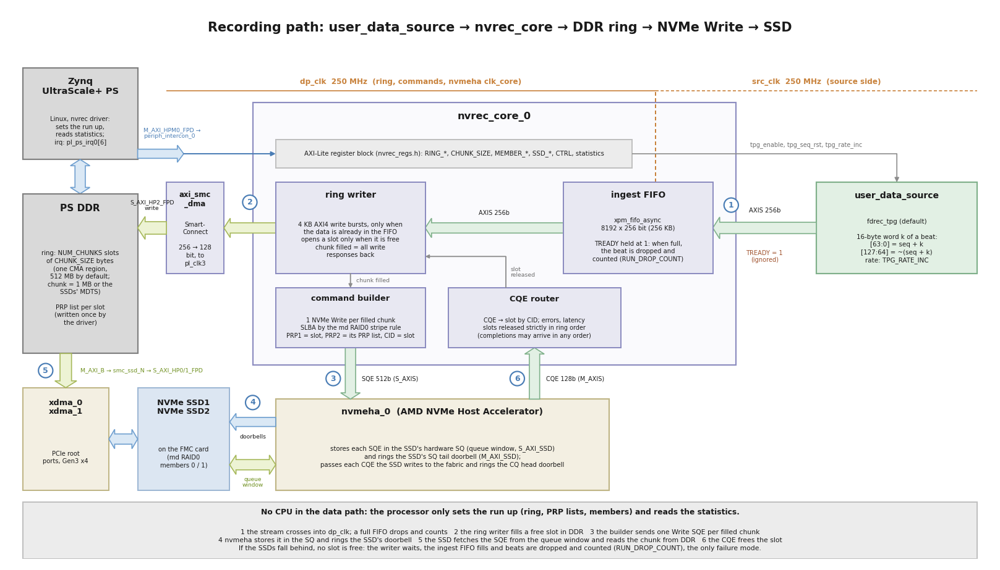
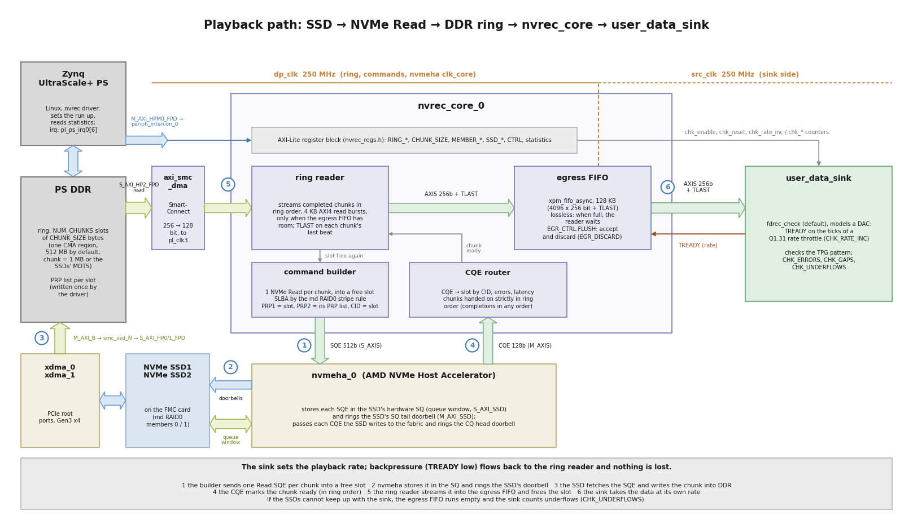
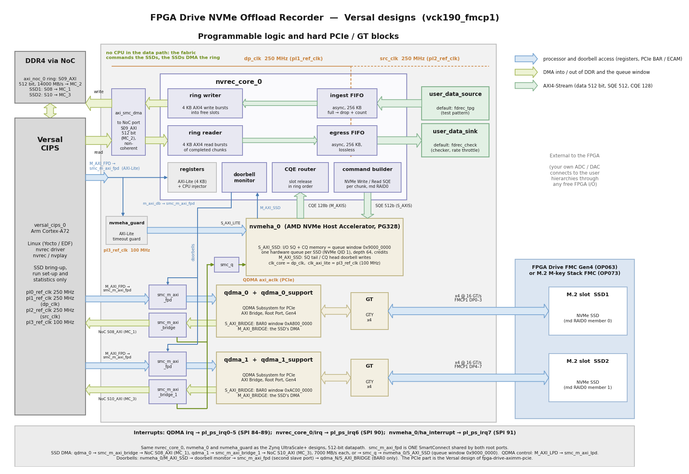

# Architecture

The design adds an NVMe offload recorder to the PCIe root-port design of
[fpga-drive-aximm-pcie](https://github.com/fpgadeveloper/fpga-drive-aximm-pcie) (the same
platform as [fpga-drive-recorder](https://github.com/fpgadeveloper/fpga-drive-recorder)). The
fabric generates (or receives) a 256-bit AXI-Stream (8.0 GB/s at 250 MHz; 512 bits and
16 GB/s on the Versal design), writes it into a ring of buffers in PS DDR, and builds one NVMe Write command per buffer. The AMD NVMe Host Accelerator IP queues
the commands and rings the SSD doorbells, and the SSD fetches the data from DDR itself. The
CPU sets the SSDs up (controller enable, Identify, I/O queue creation) and then only reads
statistics: **no CPU in the data path**.

## Block diagram (Zynq UltraScale+)

How to read the diagram:

* The **blue arrows** are register and PCIe BAR accesses: the processor's AXI-Lite access to
  the `nvrec_core` registers and (through `nvmeha_guard`) to the Host Accelerator's
  `S_AXI_LITE`, its access to the root ports' BAR and configuration (ECAM) windows, and the
  doorbell writes that the Host Accelerator itself makes into the SSDs' BAR0 (`M_AXI_SSD` →
  doorbell monitor → `smc_db` → `smc_bar_N` → `xdma_N/S_AXI_B`).
* The **green arrows** are DMA traffic: the ring writer and reader to and from the ring in DDR
  (`S_AXI_HP2_FPD`), and the SSDs' own DMA through the root ports' `M_AXI_B` (`smc_ssd_N`),
  either to DDR (`S_AXI_HPN_FPD`: the recorded data, PRP lists and admin queues) or through
  `smc_q` to the Host Accelerator's queue window (`S_AXI_SSD`), where the SSDs read their
  commands and write their completions.
* The **pale green arrows** are AXI4-Streams: the 256-bit data stream from
  `user_data_source` and to `user_data_sink`, the 512-bit command stream (one 64-byte NVMe
  SQE per beat) from the command builder into the Host Accelerator, and the 128-bit
  completion stream (one CQE per beat) back to the CQE router.
* The orange labels are the clock domains: `dp_clk` (250 MHz) for the ring, the command
  path and the Host Accelerator core, `src_clk` (250 MHz) for the source and sink, and
  `pl_clk0` (100 MHz) for the Host Accelerator's AXI-Lite interface. The asynchronous
  ingest and egress FIFOs in `nvrec_core` cross between `src_clk` and `dp_clk`. The ring's
  PS port `S_AXI_HP2_FPD` has its own clock, `pl_clk3` (see
  [Clocks and resets](#clocks-and-resets)).
* The block design is generated by one Tcl script per device family
  (`Vivado/src/bd/bd_<family>.tcl`; `bd_zynqmp.tcl` for Zynq UltraScale+, `bd_versal.tcl`
  for Versal; see [Versal designs](#versal-designs)).

The diagrams on this page are generated by `docs/source/images/gen_block_diagram.py`
(Python 3 with matplotlib); edit and run it after a change to the block design.

Cells of the block design (`Vivado/src/bd/bd_zynqmp.tcl`):

| Cell | Function |
|---|---|
| `zynq_ultra_ps_e_0`, `xdma_0`, `xdma_1`, `ref_clk_*_buf`, `periph_intercon_0/1`, `rst_pcie_*` | PS and the two PCIe Gen3 x4 root ports, unchanged from the base design |
| `user_data_source/fdrec_tpg_0` | test pattern generator (fpga-drive-recorder), the insertion point for a custom source |
| `user_data_sink/fdrec_check_0` | playback checker (fpga-drive-recorder), the insertion point for a custom sink |
| `nvrec_core_0` | this design's RTL: ingest/egress FIFOs, ring writer, command builder, completion router, ring reader, CPU command injector, doorbell monitor, registers |
| `nvmeha_0` | AMD NVMe Host Accelerator (PG328): I/O queue memory and doorbell engine |
| `axi_smc_dma` | ring writer / reader to `S_AXI_HP2_FPD`: 256 bits at `dp_clk` to 128 bits at `pl_clk3` |
| `smc_ssd_0/1` | each root port's DMA master to its HP port (DDR) and to `smc_q` |
| `smc_q` | both root ports to the Host Accelerator's queue window (`S_AXI_SSD`) |
| `smc_db`, `smc_bar_0/1` | Host Accelerator doorbell writes to the root ports' BAR windows, merged with the PS path |
| `nvmeha_guard` | AXI-Lite timeout guard (`nvrec_axil_guard`) in front of the Host Accelerator's `S_AXI_LITE` (see [Resource usage](#resource-usage)) |

## Datapath width

The fabric datapath -- `user_data_source` / `user_data_sink` streams, the ingest and egress
FIFOs and the ring writer / reader AXI4 master -- is `DATA_WIDTH` bits wide, an RTL
parameter of `nvrec_core`, `fdrec_tpg` and `fdrec_check` (128, 256 or 512). The Zynq
UltraScale+ designs (`zcu106_hpc0`, `uzev`) use **256 bits**: 32 bytes per beat at 250 MHz =
8.0 GB/s from the source and into the sink, above what their ring port into DDR can carry.
The Versal design (`vck190_fmcp1`) uses **512 bits**: 64 bytes per beat = 16.0 GB/s. The
block design scripts take the width from the target's `data_width` in `config/data.json`
(default 256; `Vivado/src/bd/nvrec_params.tcl`) and size the FIFOs in bytes: ingest 256 KB
at every width, egress 128 KB at 128 and 256 bits and 256 KB at 512 bits (optional
per-target `egress_fifo_kb`).

| `DATA_WIDTH` | Used by | Beat (`BEAT_BYTES`) | Source / sink peak at 250 MHz | Ingest FIFO | Egress FIFO | AXI burst (4 KB) |
|---|---|---|---|---|---|---|
| 128 | -- | 16 B | 4.0 GB/s | 16384 beats (256 KB) | 8192 beats (128 KB) | 256 beats |
| **256** | `zcu106_hpc0`, `uzev` | **32 B** | **8.0 GB/s** | **8192 beats (256 KB)** | **4096 beats (128 KB)** | **128 beats** |
| **512** | `vck190_fmcp1` | **64 B** | **16.0 GB/s** | **4096 beats (256 KB)** | **4096 beats (256 KB)** | **64 beats** |

The ring reader keeps up to 16 bursts (64 KB) of reads in flight, 32 bursts (128 KB) at 512
bits, and only requests a burst when the egress FIFO has room for it and for everything
already requested. At 512 bits a 128 KB egress FIFO would leave no buffered data beyond the
reads in flight, so a DDR read-latency spike shows at the sink as a short underflow during
playback at 8 GB/s and more; the 256 KB egress FIFO holds another 128 KB (about 15 us at
8.5 GB/s) behind them.

Software reads the width from the `BEAT_BYTES` register (map 1.2); the test pattern and
the recording's byte stream are the same at every width (16-byte words, see the
[register map](register_map)).

The source / sink rate is not the limit of a recording: the DDR-side path of the ring is.
On Zynq UltraScale+ that is `S_AXI_HP2_FPD`, 128 bits at `pl_clk3` = 5.16 GB/s (ZCU106) /
5.24 GB/s (UltraZed-EV) per direction; on Versal the ring's own NoC port, 512 bits at
`dp_clk` = 16.0 GB/s per direction (NoC QoS request 14000 MB/s), and then the DDR4
memory controller itself (DDR4-3200 x64, 25.6 GB/s peak, shared with both SSDs). During a recording every byte crosses DDR twice (the
ring writer writes it, the SSDs read it back).

## The record path

The recording path step by step, with the block-design cell names:

In more detail:

1. **Ingest** (`fdrec_ingest`, from fpga-drive-recorder): an asynchronous FIFO
   (8192 x 256 bits = 256 KB, 32 us at 8 GB/s) from `src_clk` to `dp_clk`. The source is
   never stalled; a beat that arrives while the FIFO is full is dropped and counted.
2. **Ring writer** (`nvrec_wr`): writes the stream into the ring, `NUM_CHUNKS` slots of
   `CHUNK_SIZE` bytes (chunk = 1 MB or the drive's MDTS, whichever is smaller; the apps default to a 512 MB ring: 512 MB / chunk slots, 256 to 2048) at `RING_BASE`, with 4 KB AXI bursts (128 beats of 256 bits). It only
   issues a burst when the data is already in the FIFO, and only opens a slot that has been
   released. A chunk is *filled* when all its write responses are back. If no slot is free
   (the SSDs are not keeping up), the writer waits, the FIFO fills and beats are dropped:
   the only failure mode, visible in `RUN_DROP_COUNT`.
3. **Command builder** (`nvrec_cmd`): one 64-byte NVMe Write SQE per filled chunk (PRP1 =
   the slot, PRP2 = the slot's PRP list built once by software, SLBA by the md RAID0 stripe
   rule, CID = slot number), pushed to the Host Accelerator's hardware interface when the
   SSD has a free queue entry (credit) and fewer than `SSD_MAX_INFLIGHT` commands are in
   flight. With two stripe members, chunks alternate between the SSDs exactly like Linux md
   RAID0 with an md chunk size of `CHUNK_SIZE`.
4. **NVMe Host Accelerator**: stores the SQE in its SQ memory, rings the SSD's SQ tail
   doorbell; the SSD reads the SQE from the queue window, DMAs the chunk from DDR, writes
   the CQE into the IP's CQ memory; the IP rings the CQ head doorbell and hands the CQE to
   the fabric.
5. **Completion router** (`nvrec_cq`): matches the CQE to its slot by CID. Completions can
   arrive in any order; slots are released strictly in ring order. It counts completions
   and errors (status field != 0, the last error is latched) and keeps latency statistics
   (min / max / sum / 16-bin log2 histogram, submit to completion).

## The playback path

Playback runs the same ring in the other direction: the SSDs write the chunks into the
ring, and the ring reader streams them into the fabric.

The builder issues NVMe Read commands into free slots, the completion router releases them
in order to the **ring reader** (`nvrec_rd`), which streams each completed chunk with 4 KB
AXI read bursts into the egress FIFO (`fdrec_egress`, 4096 x 256 bits = 128 KB on Zynq
UltraScale+, 4096 x 512 bits = 256 KB on Versal; lossless) and on to `user_data_sink`. The reader only requests a burst when the egress FIFO has room
for it, with up to 16 bursts (64 KB) outstanding (32 at 512 bits).

## Fabric-only runs (DRY)

`CONFIG.DRY` (register map 1.2) runs the fabric part of the path without the SSDs: a DRY
record writes the stream into the ring exactly like a recording but releases every slot as
soon as it is filled and never builds an NVMe command; a DRY playback streams chunks
straight out of the ring into the egress FIFO and the sink. A DRY record of exactly
`NUM_CHUNKS` chunks followed by a DRY playback of the same ring is the **ring-resident**
test: it measures the source, the ingest FIFO, the ring path into DDR and back, the egress
FIFO and the checker, and nothing else (`nvrec --no-write`, `nvplay --ring-only`). The
gap between a DRY rate and the rate of a real recording is the SSD side.

## The CPU command injector

The Host Accelerator is built with **hardware queues only** (one per SSD, NVMe queue ID 1):
PG328 numbers software queues before hardware queues, so any software queue would push the
hardware queue to QID 2, which a drive that grants a single I/O queue cannot create. All CPU
I/O (the Linux block device that carries the exFAT filesystem) therefore goes through the
command injector: software writes a complete SQE into 16 registers and submits it; it is
arbitrated round robin with the builder onto the same hardware SQ, with CID bit 15 set so
that its completion is routed into a 16-entry CQE FIFO with an interrupt. Up to 16 injected
commands can be outstanding.

## Address map (Zynq UltraScale+)

As seen from the PS (`M_AXI_HPM0_FPD` / `M_AXI_HPM1_FPD`):

| Slave | Base address | Size |
|---|---|---|
| `xdma_0` BAR0 window (PCIe, SSD1) | `0x00_A000_0000` | 256 MB |
| `xdma_1` BAR0 window (PCIe, SSD2) | `0x00_B000_0000` | 256 MB |
| `xdma_0` CTL0 (root-port config) | `0x04_0000_0000` | 512 MB |
| **`nvrec_core_0` registers** | **`0x04_2001_0000`** | 4 KB |
| **`nvmeha_0` S_AXI_LITE** (through `nvmeha_guard`) | **`0x04_2002_0000`** | 64 KB |
| `xdma_1` CTL0 (root-port config) | `0x05_0000_0000` | 512 MB |

As seen from the SSDs (the root ports' `M_AXI_B`; the root ports do not translate inbound
addresses, so these are also the PCIe bus addresses):

| Slave | Base address | Size |
|---|---|---|
| PS DDR (`HPn_DDR_LOW`) | `0x0000_0000` | 2 GB |
| PS DDR (`HPn_DDR_HIGH`) | `0x8_0000_0000` | rest of DDR |
| **Host Accelerator queue window** (`S_AXI_SSD`): SQ of SSD n at `0x9000_0000 + n*4K`, CQ at `0x9000_8000 + n*4K` | **`0x9000_0000`** | 64 KB |

As seen from the Host Accelerator's doorbell master (`M_AXI_SSD`, through the doorbell
monitor): the two BAR windows at the same addresses as the PS (`0xA000_0000`,
`0xB000_0000`), so the PCIe base register of each SSD is programmed with the BAR0 bus
address the CPU uses. As seen from the ring writer / reader (`HP2`): all of PS DDR.

The queue window is not `0xA000_0000` (PG328's example) because that is a BAR window here,
and not `0xC000_0000` / `0xE000_0000` (QSPI / PCIe-low in the HP-port map).

## Clocks and resets

| Clock | Source | Frequency | Used by |
|---|---|---|---|
| `dp_clk` | PS `pl_clk1` (IOPLL) | 250 MHz | `nvrec_core_0`, `nvmeha_0/clk_core`, `S_AXI_HP0/1_FPD`, all nvrec SmartConnects (the ring SmartConnect's slave side) |
| `src_clk` | PS `pl_clk2` (IOPLL) | 250 MHz | `user_data_source`, `user_data_sink`, ingest write / egress read side |
| `pl_clk3` | PS `pl_clk3` (RPLL) | 322.19 MHz (ZCU106), 327.77 MHz (UltraZed-EV); 333 MHz requested | `S_AXI_HP2_FPD` (the ring) and the master side of `axi_smc_dma` only |
| `pl_clk0` | PS `pl_clk0` | 100 MHz | `M_AXI_HPM0/1_FPD`, `nvmeha_0/clk_axi_lite` (PG328: at most 100 MHz) |
| `axi_aclk` | XDMA | 250 MHz | PCIe root ports |

Unlike the base design, the SSDs' DMA ports `S_AXI_HP0/1_FPD` run on `dp_clk`
(250 MHz x 128 bits = 4 GB/s per SSD) instead of `pl_clk0`. The ring's port
`S_AXI_HP2_FPD` is 128 bits wide, so it runs on its own, faster clock: `pl_clk3` is
requested at 333 MHz (the DS925 maximum for the PS-PL AXI interfaces) from the RPLL; the
PS clock wizard never exceeds a request and retunes the RPLL to the highest frequency it
can make, 322.19 MHz on the ZCU106 (`PSS_REF_CLK` 33.330 MHz) and 327.77 MHz on the
UltraZed-EV (33.333 MHz) = 5.16 / 5.24 GB/s per direction. `pl_clk1` and `pl_clk2` are
pinned to the IOPLL (`SRCSEL`) so that they stay at 250 MHz; `axi_smc_dma` converts 256 bits
at `dp_clk` to 128 bits at `pl_clk3`. The Host Accelerator runs at
250 MHz, which PG328 allows for up to 32 queues (this design has 2). Each clock domain has
its own `proc_sys_reset` (`rst_dp_clk`, `rst_src_clk`, `rst_lite_clk`), released by
`pl_resetn0`. The clock-domain crossings in `nvrec_core` use XPM macros; the Host
Accelerator's own XDC declares `clk_core` and `clk_axi_lite` asynchronous.

## Interrupts

| `pl_ps_irq0` bit | Source | GIC SPI |
|---|---|---|
| 0-5 | XDMA root ports (as in the base design) | 89-94 |
| 6 | `nvrec_core_0/irq` (level: run done, command error, overflow, injector CQE, unexpected CQE, aborted) | 95 |
| 7 | `nvmeha_0/ha_interrupt` (address error, SQE without credit, SSD timeout) | 96 |

## Versal designs

The `vck190_fmcp1` design (`Vivado/src/bd/bd_versal.tcl`) is the Versal base design of
fpga-drive-recorder (CIPS, NoC, two QDMA Root Ports in AXI bridge mode, with two PCIe PIPE
pipeline stages for timing closure) with the same `nvrec_core`, `nvmeha_0` and
`nvmeha_guard` as the Zynq UltraScale+ designs. The differences:

* **Clocks.** CIPS `pl1_ref_clk` = 250 MHz `dp_clk`, `pl2_ref_clk` = 250 MHz `src_clk`,
  and a third clock `pl3_ref_clk` = 100 MHz for the Host Accelerator's AXI-Lite interface
  and the guard.
* **512-bit datapath.** Source, sink, both FIFOs and the ring writer / reader are 512 bits
  wide (`data_width` 512): 16 GB/s at 250 MHz.
* **Ring writer / reader** reach DDR through their own NoC port (`axi_smc_dma` ->
  `axi_noc_0/S09_AXI`, a PL NMU 512 bits wide at `dp_clk`, DDR memory controller port
  `MC_2`). Its NoC QoS request is 14000 MB/s read and write: the NoC compiler adds the
  packetization overhead (write data x 1.0625, read requests 1/16 of the read rate) and
  accepts at most 16000 MB/s per NMU and per memory-controller port, so 16000 MB/s is not
  feasible.
* **One NoC port per root port.** `qdma_0/M_AXI_BRIDGE` goes through `smc_m_axi_bridge` to
  NoC port `S08_AXI` (`MC_1`), `qdma_1/M_AXI_BRIDGE` through `smc_m_axi_bridge_1` to its own
  NoC port `S10_AXI` (`MC_3`), each 256 bits at `pl0_ref_clk` with a QoS request of
  7000 MB/s per direction (a Gen4 x4 link moves up to ~7 GB/s). The second master port of
  each of these SmartConnects goes to `smc_q`, which merges both root ports' paths to the
  Host Accelerator's queue window (`S_AXI_SSD`), as on Zynq UltraScale+. Two NoC ports
  instead of one shared port give each SSD's DMA its own NMU and request. The QoS values are bandwidth
  requests to the NoC compiler, not caps; `report_noc_qos` on the implemented design
  confirms them.
* **Doorbells.** The Host Accelerator's doorbell master (through the doorbell monitor) is a
  second master of `smc_m_axi_fpd`; its address space contains only the two BAR0 windows.
* **Interrupts.** `nvrec_core` on `pl_ps_irq6` (GIC SPI 90), `nvmeha_0/ha_interrupt` on
  `pl_ps_irq7` (SPI 91).

Address map as seen from the PS (`M_AXI_FPD`):

| Slave | Base address | Size |
|---|---|---|
| `qdma_0` BAR0 window (32-bit, SSD1) | `0x00_A800_0000` | 64 MB |
| `qdma_1` BAR0 window (32-bit, SSD2) | `0x00_AC00_0000` | 64 MB |
| **`nvrec_core_0` registers** | **`0x04_2001_0000`** | 4 KB |
| **`nvmeha_0` S_AXI_LITE** (through `nvmeha_guard`) | **`0x04_2002_0000`** | 64 KB |
| `qdma_0` / `qdma_1` 64-bit BAR windows | `0x04_8000_0000` / `0x04_C000_0000` | 1 GB each |

As seen from the SSDs (`M_AXI_BRIDGE`; the bridges translate no addresses): DDR at
`0x0` (2 GB) and `0x500_0000_0000` (6 GB), and the Host Accelerator queue window at
`0x9000_0000` (64 KB), as on Zynq UltraScale+. The doorbell master sees the BAR0 windows at
the same addresses as the PS, so an SSD must get its BAR0 in the 32-bit windows: an SSD
with a prefetchable BAR0, which Linux would place in a 64-bit window, cannot be used (the
driver refuses it).

## Resource usage

Post-implementation utilization of the `zcu106_hpc0` build (XCZU7EV), whole design including
the PS-side IP, both PCIe root ports and the NVMe Host Accelerator:

| Resource | Used | Available | % |
|---|---|---|---|
| CLB LUTs | 68 949 | 230 400 | 29.9 |
| CLB registers | 108 341 | 460 800 | 23.5 |
| Block RAM tiles (36 Kb) | 171.5 | 312 | 55.0 |
| UltraRAM | 0 | 96 | 0 |
| DSP | 0 | 1 728 | 0 |

Timing is met (register map 1.2 build, 256-bit datapath, 2026-10-22: WNS +0.386 ns,
WHS +0.010 ns; `pl_clk3` (HP2, 322.19 MHz) +0.386 ns, `dp_clk` +0.407 ns, `src_clk`
+0.420 ns, `pl_clk0` +5.503 ns). The ring writer and reader plan each burst over 4 clock
cycles and the completion router releases slots every 2 cycles; the tightest paths are the
address fan-out of the 256 KB ingest / 128 KB egress FIFO block RAMs and the HP2-side
width converter of `axi_smc_dma`.

The other targets (register map 1.2 builds, 2026-10-22; `vck190_fmcp1` 2026-10-23):

| Target | Device | CLB LUTs | Registers | Block RAM | UltraRAM | WNS |
|---|---|---|---|---|---|---|
| `uzev` | XCZU7EV | 68 992 (29.9 %) | 108 370 (23.5 %) | 171.5 (55.0 %) | 0 | +0.096 ns |
| `vck190_fmcp1` (512-bit) | XCVC1902 | 91 240 (10.1 %) | 132 068 (7.3 %) | 205 (21.2 %) | 24 (5.2 %) | +0.036 ns |

On `uzev` the worst path is the HP2-side FIFO of `axi_smc_dma` at `pl_clk3` = 327.77 MHz.
On `vck190_fmcp1` the worst path is in the base design's PCIe PIPE clock (`ch0_txoutclk`);
`dp_clk` closes with +0.254 ns and `src_clk` with +0.098 ns (the 256 KB egress FIFO's read
side), WHS +0.007 ns. `report_noc_qos` on the implemented design: status OPTIMAL, the ring
port `S09_AXI` gets its 14000 MB/s read and write, the root ports' `S08_AXI` and `S10_AXI`
their 7000 MB/s read and write each.

Vivado reports `IP license key 'nvmehc@2019.04' is enabled with a Hardware_Evaluation
license` when the evaluation license is used: the bitstream then contains the evaluation
core, which stops working after a time limit set by AMD (183-184 min after the bitstream load,
measured on the ZCU106; reload the bitstream to restart it). The expired core's register slave
no longer answers; the AXI-Lite timeout guard `nvmeha_guard` (`nvrec_axil_guard`) in front of
it keeps the CPU from hanging and reports the condition in `nvrec_core` `STATE.HA_DEAD` (see
[Register map](register_map)), and the driver then fails cleanly.
