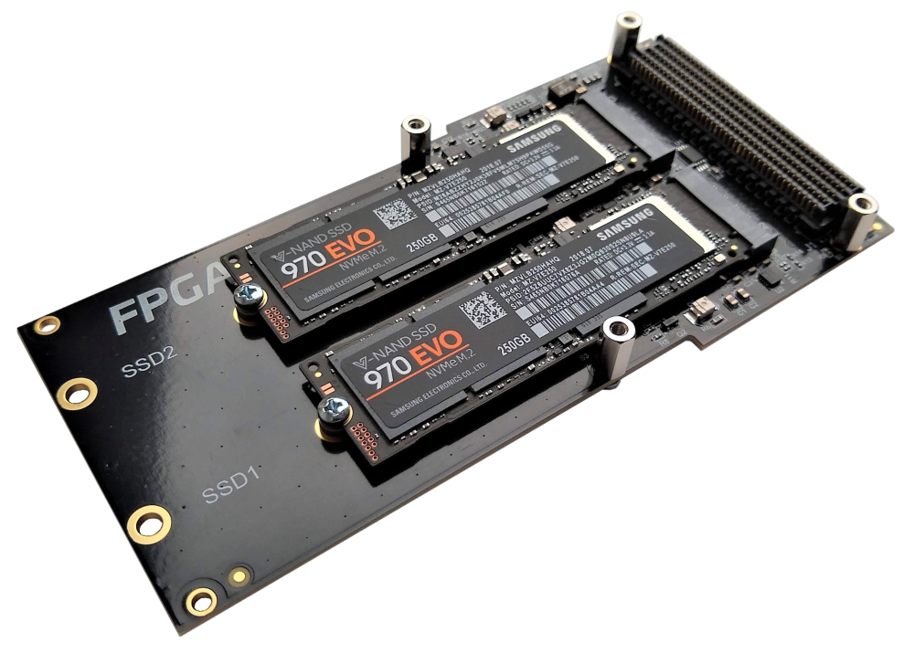
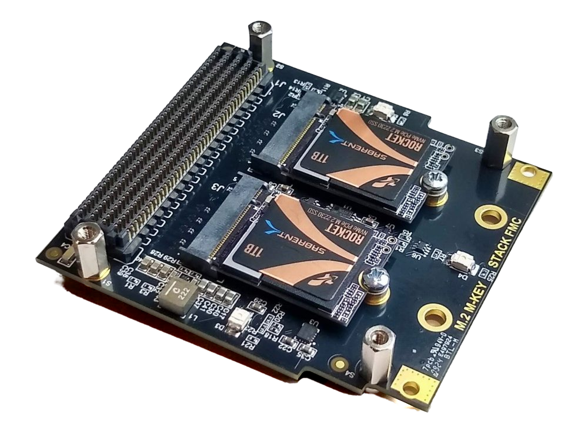

# Description

The FPGA Drive NVMe Offload Recorder is a reference design that records data generated in
the FPGA fabric to a file on one or two NVMe SSDs, and plays recordings back into the
fabric, **with no CPU in the data path**. The SSDs connect to the FPGA through the FMC
connector with Opsero's [FPGA Drive FMC Gen4] (OP063) or [M.2 M-key Stack FMC] (OP073).

| FPGA Drive FMC Gen4 | M.2 M-key Stack FMC |
|---|---|
|  |  |

```{important}
**This design needs an IP license.** It contains the AMD [NVMe Host Accelerator] IP
(`nvmeha`, PG328), which is licensed separately from Vivado. You need a purchased or an
evaluation license for it to build any target of this design. Evaluation licenses are
free from AMD; a bitstream built with one stops the Host Accelerator 183-184 minutes
(about 3 hours) after it was loaded (see [Requirements](requirements.md#nvme-host-accelerator-license)). No other
FPGA Drive reference design needs an IP license.
```

## What the design does

Linux runs on the processor of the target board. It brings the SSDs up, provides the
filesystem and reads the statistics, but it does not move or command the data:

* The fabric writes the data stream into a ring of buffers ("chunks") in the processor's
  DDR memory. The ring is one physically contiguous region that the `nvrec` kernel driver
  allocates at the start of a run.
* For every filled chunk, fabric logic (`nvrec_core`) builds a 64-byte NVMe Write command
  and hands it to the AMD NVMe Host Accelerator, which queues it and rings the SSD's
  doorbell. The SSD reads the chunk from DDR by itself.
* The completions come back to the fabric, which releases the chunks in ring order. With
  two SSDs, the chunks are striped exactly like a Linux md RAID0 array.
* The CPU never reads, writes, copies or commands the data. After the setup, it only reads
  statistics: one NVMe command per chunk (1 MB, or the SSD's maximum transfer size if that
  is smaller), up to 63 commands in flight per SSD, all issued and completed in hardware.

The recording is an ordinary file on an exFAT filesystem: `nvrec` preallocates it as one
contiguous run of clusters, unmounts the volume while the hardware writes, and fixes up
the file afterwards (see [Filesystem and striping](filesystem)). You copy recordings off
the board with `scp`, or move the SSDs to a PC.

The data source is a block-design hierarchy (`user_data_source`) with an AXI4-Stream
output at 250 MHz: 256 bits wide (up to 8 GB/s) on the Zynq UltraScale+ targets, 512 bits
(up to 16 GB/s) on the Versal target; the width is a build parameter (128, 256 or 512 bits). In the reference design it holds a test pattern generator, which
models an ADC: it produces data at a programmable rate and cannot be stalled. You replace
it with your own ADC, sensor or processing logic (see [custom data source](custom_source)).
If the SSDs cannot keep up, the data that does not fit is dropped and counted in the
fabric, never silently lost: every recording reports its drop count, and a valid
recording has a drop count of zero. The `nvverify` tool checks a test-pattern recording
word by word. A fabric-only mode runs the recorder and the player without any SSD, to
measure what the fabric and the DDR path sustain on their own.

Playback runs the same path in reverse: the fabric issues NVMe Read commands into the ring,
and streams the completed chunks into a second hierarchy, `user_data_sink`. In the
reference design that hierarchy holds a hardware checker that consumes the stream at a
programmable rate, like a DAC, and verifies every beat. You can replace it with your own
logic (see [custom data sink](custom_sink)).

The PCIe part, one PCIe Root Port per M.2 slot, is the design of
[fpga-drive-aximm-pcie](https://github.com/fpgadeveloper/fpga-drive-aximm-pcie); this design
adds the data source and sink, `nvrec_core` and the NVMe Host Accelerator. See
[Architecture](architecture) for the block diagram and the details.

## Positioning

This design is the hardware counterpart of the [FPGA Drive Recorder] ([fpga-drive-recorder]),
which records the same fabric stream through the Linux NVMe driver with zero-copy
`O_DIRECT` writes. The two designs share the test pattern generator, the checker, the
`user_data_source` / `user_data_sink` insertion points and the stream contract, so a custom
source or sink carries over unchanged.

| | FPGA Drive Recorder | FPGA Drive NVMe Offload Recorder (this design) |
|---|---|---|
| Who issues the NVMe commands | Linux (io_uring, NVMe driver, block layer) | Fabric logic and the NVMe Host Accelerator IP |
| CPU during a recording | bookkeeping for every buffer | none (statistics only) |
| Commands in flight per SSD | 8 (default) | up to 63 (default 32) |
| Filesystem | XFS (or ext4), any file layout | exFAT, one contiguous preallocated file per recording |
| SSD driver | stock Linux `nvme` | the design's `nvrec` driver (the SSD belongs to the IP's queues) |
| IP license | none | NVMe Host Accelerator license required |

Choose this design when the CPU must stay free, or when Linux cannot sustain the rate you
need; choose fpga-drive-recorder when you want a standard Linux storage stack and no IP
license. Measured rates of the two designs side by side are on the
[comparison](comparison) page. If you only need the SSDs as Linux block devices, or a
standalone PCIe test, use
[fpga-drive-aximm-pcie](https://github.com/fpgadeveloper/fpga-drive-aximm-pcie).

## Hardware platforms

The design supports the target boards listed below. All of them use two M.2 slots, each
with its own 4-lane PCIe Root Port.


    
    
        
            
        
    
    
### {{ group.name }} platforms

| Target board        | Target design | FMC Slot<br> Used | Active<br>M.2 Slots | PCIe IP | NVMe host IP | Yocto |
|---------------------|---------------|-------------------|---------------------|---------|--------------|-------|
| [{{ design.board }}]({{ design.link }}) | `{{ design.label }}` | {{ design.connector }} | {{ design.lanes | length }}x | [{{ design.ip }}]({{ data.ips[design.ip].link }}) | [nvmeha]({{ data.ips["nvmeha"].link }}) |  ✅  ❌  |




## IP cores

The PCIe Root Ports use the integrated PCIe blocks of the device and need no license. The
**NVMe Host Accelerator needs a license** (purchased or evaluation) on every target. The
custom logic (`nvrec_*` and `fdrec_*`) is open source, part of this repository
(`Vivado/src/hdl/`).

| IP Label       | IP Name     |
|----------------|-------------|
| {{ label }} | [{{ ip.name }}]({{ ip.link }}) |


## M.2 slots

You can record to one SSD or to both SSDs at once, striped in the Linux md RAID0 layout
(`nvsetup-raid0.sh`), which roughly doubles the rate that the SSDs can sustain. Because
the layout is md's, the array also assembles with `mdadm` on a PC.

## Software

The design runs embedded Linux built with the AMD Yocto / Embedded Development Framework
(EDF) flow. There is no PetaLinux flow and no standalone (baremetal) application. The
Linux image contains:

| Component | What it does |
|-----------|--------------|
| `nvrec.ko` | Kernel driver: owns the SSDs (instead of the stock `nvme` driver), creates their I/O queues inside the Host Accelerator, provides the block devices `/dev/nvrecXn1` and the control device `/dev/nvrec` ([Kernel driver](driver)) |
| `nvsetup-raid0.sh` | Prepare the recording volume: one SSD or an md RAID0 array of two, exFAT ([Applications](apps)) |
| `nvrec` | Record the fabric stream to a file |
| `nvplay` | Play a recording back into the fabric |
| `nvverify` | Verify a test-pattern recording word by word |
| `nvbench.sh` | Find the sustained recording rate of a board + SSD combination |
| `nvbench-suite.sh` | Run the whole benchmark matrix of the [Benchmarks](benchmarks) page |
| `nvregs` | Dump the hardware registers (support and debugging) |
| Tools | `nvme-cli`, `mdadm`, `exfatprogs`, `fio`, `pciutils`, `devmem2` and others |

[FPGA Drive FMC Gen4]: https://docs.opsero.com/op063/datasheet/overview/
[M.2 M-key Stack FMC]: https://docs.opsero.com/op073/datasheet/overview/
[NVMe Host Accelerator]: https://docs.amd.com/r/en-US/pg328-nvme-host-accelerator
[FPGA Drive Recorder]: https://recorder.fpgadrive.com
[fpga-drive-recorder]: https://github.com/fpgadeveloper/fpga-drive-recorder
